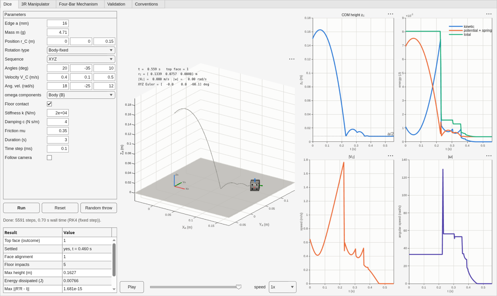

# Rigid-body simulator: a tumbling die, a 3R arm and a four-bar linkage

**Three-dimensional rigid-body dynamics in MATLAB, from Newton's and Euler's equations up:
a thrown die that lands on a face nobody chose, a planar three-link manipulator with
recursive Newton–Euler dynamics and four controllers, and a four-bar linkage solved through
its loop-closure constraint — with an interactive lab app, diagnostic dashboards and 115
tests that check the physics against closed-form answers and conservation laws.**

[](https://github.com/Samarth030312/rigid-body-simulator/actions/workflows/ci.yml)


<p align="center">
  
  <br><sub>A 16 mm die, thrown at 0.4 m/s with 33 rad/s of spin. The face it shows at the end
  is read from the simulated orientation; nothing about the outcome is prescribed.</sub>
</p>

Three mechanisms, one core. The same rotation matrices, inertia tensors and Newton–Euler
routines serve all three models, so a sign convention is written once and tested once.

## Get it running

MATLAB R2021b or newer, on Windows, macOS or Linux. **No toolbox is required** — base
MATLAB only, nothing to install, nothing to compile.

```matlab
gitclone("https://github.com/Samarth030312/rigid-body-simulator.git", Depth=1); cd rigid-body-simulator; setup open
```

That puts the repository on the path, checks the computer and opens the lab app. Then,
step by step: **[replicate](docs/REPLICATE.md)**.

Without the app:

```matlab
setup
res = rbsim.dice.simulate(rbsim.dice.defaults());   res.summary
rigid_body_examples      % the reference numbers below
setup test               % 115 tests, about two minutes
```

## What it shows

Reproduce any of these with `rigid_body_examples`; the full account is in
**[results](docs/RESULTS.md)**.

- **Free flight is exact, not approximately exact.** With the floor switched off, the die's
  trajectory is the analytic parabola and its orientation the closed-form fixed-axis
  rotation. Over 0.3 s the energy moves by 6×10⁻¹⁷ J and the angular momentum by 4×10⁻²⁰ —
  rounding, not physics.
- **The outcome of a throw is produced, not chosen.** The uppermost face is read from the
  final rotation matrix. Eight throws differing only in initial spin settle on at least
  three different faces; every one lands flat to better than 0.01°; repeating a throw
  repeats the face, and halving the time step does not change it.
- **The recursive manipulator dynamics reduce to the textbook case.** Give the third link
  no mass and the three-link inverse dynamics reproduces the standard closed-form planar
  two-link equations to 10⁻¹¹ N·m, term for term.
- **Energy is a measurement here, not a slogan.** The undamped arm holds 28 J to within
  9×10⁻⁶ J over two seconds; with damping, the energy lost equals the damper work to
  7×10⁻⁹ J, because the work is integrated alongside the state rather than summed afterwards.
- **The linkage stays closed.** Driven through full turns, the largest residual of the
  loop-closure equations is 8×10⁻¹⁶ m, and it does not grow with time: position is solved
  from the constraint at every sample instead of being integrated.
- **The dynamics are checked against a second, independent derivation.** The four-bar's
  crank acceleration from nine free-body equations agrees with a one-degree-of-freedom
  energy equation to 10⁻⁶, and that route also yields the joint reaction forces — 15.9 N
  peak at the crank bearing for the shipped geometry.

## The three models

| | Kinematics | Dynamics | Drawn |
|---|---|---|---|
| **Die** | orientation as a rotation matrix; rotations about body-fixed or space-fixed axes in any of the twelve triples; both angular-velocity forms | Newton in the world frame, Euler about the centre of mass in the body frame, cube inertia, gravity; optional penalty contact with the floor | cube with pips, body frame, trajectory, velocity and spin arrows |
| **3R arm** | frame composition; velocity and acceleration propagated link by link to the tool | recursive Newton–Euler inverse dynamics; mass matrix assembled from it for forward dynamics; free, constant-torque, PD and computed-torque control | links, joints, centres of mass, link frames, tool path |
| **Four-bar** | loop closure in Freudenstein's form, solved in closed form with an explicit assembly branch; velocities and accelerations from the differentiated constraint; Grashof classification; toggle detection | per-link free-body Newton–Euler giving the crank acceleration or the required torque, and every joint reaction | ground, crank, coupler, rocker, coupler-point curve |

Each returns the same result struct, which is why one app and one dashboard serve all three.

## How it is kept honest

Four kinds of evidence, in order of preference: a **closed-form answer** (the projectile,
the freely precessing symmetric top, a rotation matrix for known angles); a **conservation
law** (energy and angular momentum, or the work done when they should change); an
**independent second derivation** (the linkage's energy equation against its free-body
solution, the arm's mass matrix against a link-by-link kinetic energy, the inertia formulas
against a direct discretisation of the defining integral); and **finite differences** for
every claimed velocity or acceleration relation. Details in
**[validation](docs/validation/VALIDATION.md)**.

The mechanics never reaches up into the app or the drawing code — a test enforces it by
inspecting the source — so every model runs head-less and is testable on its own.

## Documentation

| | |
|---|---|
| [First principles](docs/FIRST_PRINCIPLES.md) | what is computed, in the order it is computed, and the check on each step |
| [How it works](docs/HOW_IT_WORKS.md) | the pipeline from a parameter struct to a drawn scene |
| [Replicate](docs/REPLICATE.md) | run it, check it, change it, regenerate the figures |
| [Results](docs/RESULTS.md) | what the three models show |
| [Conventions](docs/architecture/CONVENTIONS.md) | frames, rotation order, units, state layouts — frozen |
| [Code layout](docs/architecture/MATLAB.md) | packages, layering, the result struct, naming |
| [Decisions](docs/knowledge-base/ENGINEERING_DECISIONS.md) | numbered, with the alternatives rejected |
| [References](docs/knowledge-base/REFERENCES.md) | the standard works the mechanics comes from |
| [Open items](docs/knowledge-base/OPEN_ITEMS.md) | known limitations |
| [Troubleshooting](docs/TROUBLESHOOTING.md) | every error the code raises, and its fix |

## Layout

```
setup.m                      path, checks, app, tests — the only entry point
matlab/functions/+rbsim/     math · body · solver · dice · robot · fourbar · viz
matlab/apps/rigid_body_lab/  the lab app
matlab/scripts/              worked examples, playground, figure generation
matlab/tests/                115 tests, matlab.unittest
docs/                        the pages above
scripts/validation/          repository hygiene, also run in CI
```

## Licence

MIT — see [LICENSE](LICENSE). No third-party code is vendored; see
[THIRD_PARTY.md](THIRD_PARTY.md).
