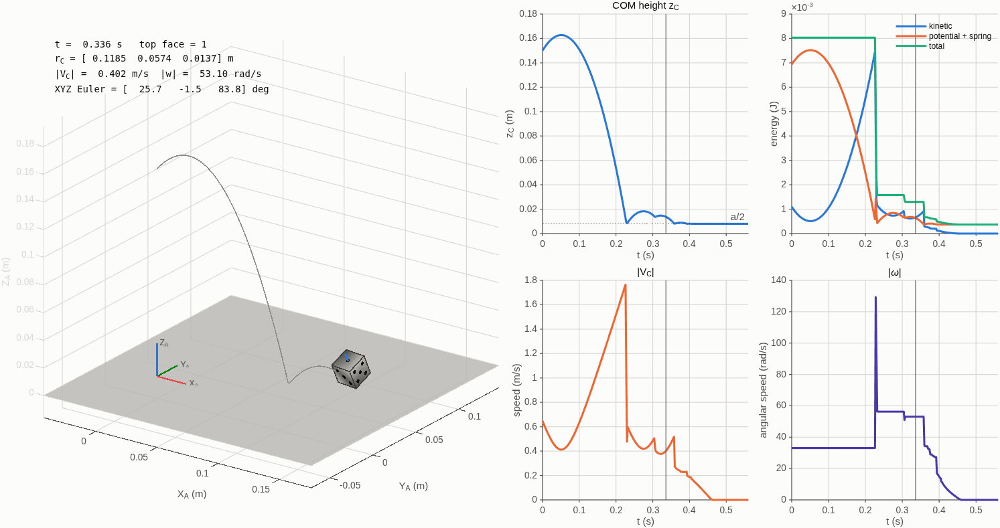
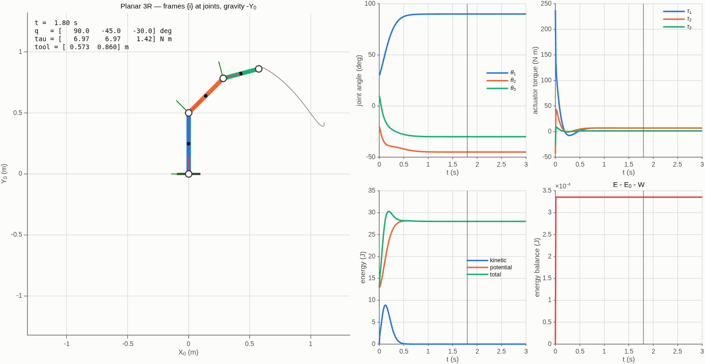
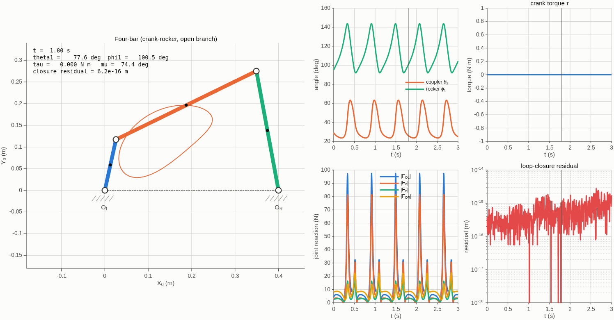

# Results

What the three models show when they are run as shipped. Everything here is reproducible
with `rigid_body_examples` or `setup figures`.

## The die

A 16 mm, 4.7 g cube thrown from 0.15 m with 0.4 m/s across the floor and 33 rad/s of spin.

- **Free flight is exact.** With contact switched off the trajectory is the analytic
  parabola and the orientation is the closed-form fixed-axis rotation; over 0.3 s the
  energy moves by 6×10⁻¹⁷ J and the angular momentum by 4×10⁻²⁰ — rounding, not physics.
- **Landing is a sequence of distinct events.** The default throw makes seven separate
  floor contacts and comes to rest at 0.46 s. The energy trace steps down at each one and
  never rises: the contact model only ever removes energy.
- **The outcome is produced, not chosen.** The face is read from the final orientation.
  Eight throws differing only in initial spin settle on at least three different faces, and
  every one of them lands flat (the uppermost normal within 0.04° of vertical). Repeating a
  throw repeats the face exactly; halving the time step does not change it.
- **The rotation stays a rotation.** The largest correction back onto SO(3) over a whole
  throw is about 7×10⁻⁷, and the orthonormality error never exceeds 2×10⁻¹⁵.

## The 3R arm

Three links of 0.5, 0.4 and 0.3 m and 3, 2 and 1 kg, under gravity.

- **The recursive solution is the textbook one.** Give the third link no mass and the
  three-link inverse dynamics reproduces the standard closed-form planar two-link equations
  to 10⁻¹¹ N·m, term for term, over a range of random configurations.
- **Energy is conserved when it should be.** Released from rest and left undamped, the arm
  swings chaotically for two seconds with the total energy moving by 9×10⁻⁶ J out of 28 J.
  With joint damping, the energy lost equals the damper work to 7×10⁻⁹ J.
- **Computed torque tracks to the numerics.** Following a quintic joint trajectory, the
  tracking error is 4×10⁻¹² rad — the model inverted by the controller is the same model
  being simulated, so only integration error remains.
- **Gravity torques are a gradient.** The static holding torque at any configuration equals
  the derivative of the potential energy, computed independently.

## The four-bar linkage

Ground 0.40 m, crank 0.12 m, coupler 0.36 m, rocker 0.28 m — a crank-rocker.

- **The loop stays closed.** Driven at 360 °/s, the largest residual of the closure
  equations over a full turn is 8×10⁻¹⁶ m. It does not grow with time, because position is
  solved from the constraint at every sample rather than integrated.
- **The rocker oscillates, the crank rotates.** The output angle sweeps 92° to 144°, which
  is what Grashof's criterion predicts for these lengths; the transmission angle stays above
  50°, so the mechanism never approaches a toggle.
- **The dynamics agree with an independent derivation.** The crank acceleration from the
  nine free-body equations matches the one-degree-of-freedom energy equation to 10⁻⁶, and
  the driving torque times the crank rate matches the rate of change of the mechanism's
  energy.
- **The reactions are real numbers, not a by-product.** Peak pin force at the crank bearing
  is about 16 N for these masses at this speed — the quantity a designer would size a
  bearing from, available because the dynamics were assembled from free-body diagrams.
